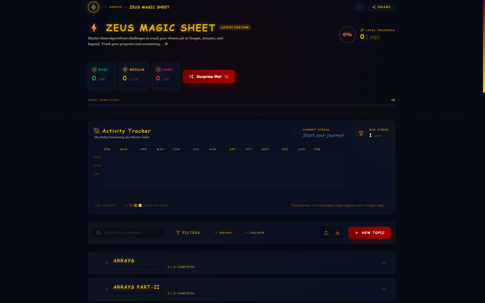

# <p align="center">🚀 Sheets - Interactive Question Management System</p>

<p align="center">
  
  
  
  
  
</p>

---

<p align="center">
  <strong>A modern, premium interactive web application for managing hierarchical questions.</strong><br />
  Designed specifically for tracking progress through the <strong>ZEUS SDE Sheet</strong> and other curated DSA curriculum.
</p>

<p align="center">
  
</p>

---

## ✨ Final Implementation Status

The application is **100% complete** and production-ready, featuring the full **ZEUS SDE Sheet** dataset.

- 💎 **Complete Dataset**: 27 topics and 191+ real questions integrated.
- ⚡ **Full CRUD**: Create, Read, Update, and Delete topics, sub-topics, and questions.
- 🎯 **Drag & Drop**: Intuitive reordering at all hierarchical levels using `@dnd-kit`.
- 🔍 **Pro Search & Filter**: Real-time search and multi-criteria filters (status, difficulty).
- 📈 **Progress Tracking**: Visual progress bars and completion statistics.
- 💾 **Data Persistence**: Automatic saving to `localStorage` via Zustand.
- 📤 **Import/Export**: Backup and restore your study progress as JSON.
- 📱 **Mobile Optimized**: Fully responsive interface for all device sizes.

---

## 📊 Dataset: ZEUS SDE Sheet

The app comes pre-loaded with **27 Topics** covering essential DSA concepts:

| Topic | Focus Area | Questions |
| :--- | :--- | :--- |
| **Arrays** | Basic to Advanced manipulations | 24 |
| **Linked List** | SLL, DLL, and cycle detection | 18 |
| **Greedy** | Optimization problems | 6 |
| **Recursion** | Backtracking and basic recursion | 11 |
| **Trees** | Binary Trees & BST | 41 |
| **Graphs** | Traversals and Shortest Paths | 18 |
| **DP** | Classical Dynamic Programming | 16 |

> **Platform Coverage**: LeetCode, GeeksforGeeks, InterviewBit, Spoj, and Codestudio.

---

## 📋 Project Requirements

### ✅ Functional Requirements
- **Add Topic**: Create, edit, and delete main topics.
- **Add Sub-topic**: Create, edit, and delete sub-topics under existing topics.
- **Add Question**: Create, edit, and delete questions under specific topics and sub-topics.
- **Reorder Elements**: Change the order of topics, sub-topics, and questions via drag-and-drop.

### ⚙️ Technical Requirements
- **Framework**: Built with **React 18.3+** for high performance.
- **Styling**: Modern dark-theme UI using **Tailwind CSS v4.1**.
- **State**: **Zustand** for lightweight, transactional state management.
- **Reference**: UI design and functionality inspired by the **Codolio** platform.

---

## 🚀 Getting Started

### Prerequisites
- Node.js 18+
- npm or yarn

### Installation
1. **Clone the repository**:
   ```bash
   git clone https://github.com/mayankkmauryaa/Sheets.git
   cd Sheets
   ```
2. **Install dependencies**:
   ```bash
   npm install
   ```
3. **Start the development server**:
   ```bash
   npm run dev
   ```
4. Open [http://localhost:3000](http://localhost:3000) in your browser.

---

## 🎯 Deployment Guide

### ☁️ Netlify (Recommended)
```bash
npm run build
npx netlify deploy --prod --dir=dist
```

### ⚡ Vercel
```bash
npm install -g vercel
npm run build
vercel --prod dist
```

---

## 🏗 Project Structure

```text
Sheets/
├── public
│   └── favicon.svg
├── src
│   ├── components
│   │   ├── ActivityGraph.jsx
│   │   ├── Controls.jsx
│   │   ├── Dashboard.jsx
│   │   ├── Header.jsx
│   │   ├── Question.jsx
│   │   ├── QuestionList.jsx
│   │   ├── SubTopic.jsx
│   │   ├── SubTopicList.jsx
│   │   ├── Topic.jsx
│   │   └── TopicList.jsx
│   ├── store
│   │   ├── keys.js
│   │   └── sheetStore.js
│   ├── App.css
│   ├── App.jsx
│   ├── index.css
│   └── main.jsx
├── .gitignore
├── README.md
├── eslint.config.js
├── index.html
├── package-lock.json
├── package.json
├── tsconfig.json
└── vite.config.js
```

---

## 🏆 Competitive Advantages

- 🎨 **Premium UI**: Clean, modern design with dark mode and smooth micro-animations.
- 🔒 **Privacy First**: All data is stored locally in your browser. No internet required.
- 🛠 **Fully Customizable**: Unlike static sheets, this app allows full content control.
- 🚀 **High Performance**: Optimized bundle (~300KB) for instant load times.

---

## 📜 License & Support

This project is licensed under the **MIT License**.
For support, contact **hpmayankmaurya@gmail.com** or open an issue in the repository.

---

## 📝 Submission Details

- **Deadline**: February 10th, 11:59 PM.
- **Repository**: [mayankkmauryaa/Sheets](https://github.com/mayankkmauryaa/Sheets)
- **Instructions**: See the [Getting Started](#-getting-started) section.

---

<p align="center">
  <i>Built with ❤️ for the DSA Community</i>
</p>
